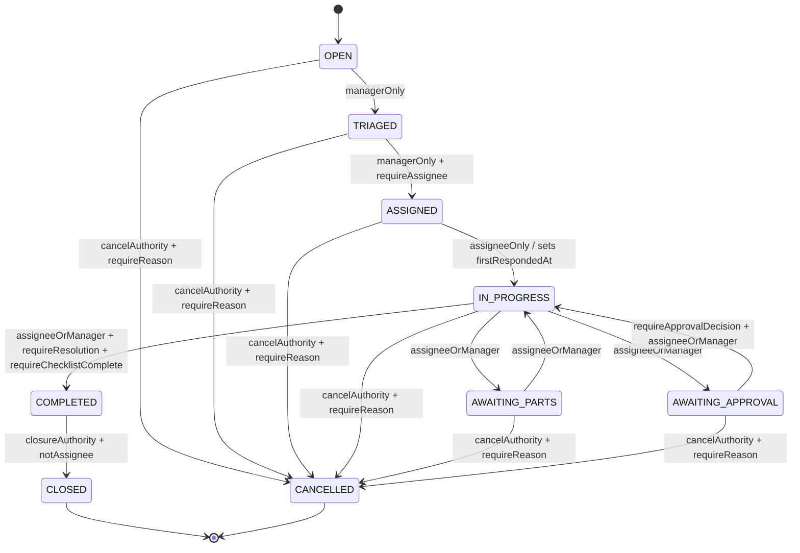

# ADR-0013: Work-order state machine

- Status: Accepted
- Date: 2026-11-20

## Context

FR-03 prescribes the lifecycle `OPEN -> TRIAGED -> ASSIGNED -> IN_PROGRESS ->
AWAITING_PARTS / AWAITING_APPROVAL -> IN_PROGRESS -> COMPLETED -> CLOSED` plus `CANCELLED`
with a reason. The API must validate authorized transitions and required fields; completion
requires a resolution and all mandatory checklist items (A-05); closure requires manager
verification or requester acceptance (configurable); technicians cannot self-approve; closed
orders cannot be edited; reopening creates a linked follow-up order.

## Decision Drivers

- Rules testable without a database, at 100% branch coverage.
- Same rules available to the web client to render only valid actions.
- Immutability: no hidden mutation of loaded orders.
- Typed failures that map cleanly onto HTTP errors.

## Considered Options

1. Pure, table-driven state machine in `@assetops/shared` returning `Result` values.
2. Status checks scattered across service methods.
3. Database triggers enforcing transitions.
4. A third-party state chart library.

## Decision Outcome

Chosen option 1, implemented in `packages/shared/src/domain/work-orders/`:

- `types.ts`: statuses, priorities, `ClosurePolicy` (`MANAGER_VERIFICATION` |
  `REQUESTER_ACCEPTANCE`), `WorkOrderState`, `TransitionRequest`, `TransitionContext`.
- `guards.ts`: composable guards returning a typed error or `null`.
- `transitions.ts`: the lifecycle graph `TRANSITIONS[from][to] = { guard, effect }`.
- `state-machine.ts`: `canTransition`, `transition`, `allowedTargets`, `ensureEditable`,
  `isTerminal`.

`transition(order, request, context)` returns `{ ok: true, value: { order, event } }` with a
new order (`version + 1`) and a `WorkOrderEvent` to persist, or `{ ok: false, error }` with
one of: `ORDER_LOCKED`, `INVALID_TRANSITION`, `ROLE_NOT_PERMITTED`, `NOT_ASSIGNEE`,
`SELF_APPROVAL`, `ASSIGNEE_REQUIRED`, `RESOLUTION_REQUIRED`, `CHECKLIST_INCOMPLETE`,
`REASON_REQUIRED`, `APPROVAL_REQUIRED`. The input is never mutated.

Guard semantics (`guards.ts`):

| Guard                    | Rule                                                                                            | Error                |
| ------------------------ | ----------------------------------------------------------------------------------------------- | -------------------- |
| managerOnly              | actor is `ORG_ADMIN` or `FACILITY_MANAGER`                                                      | ROLE_NOT_PERMITTED   |
| assigneeOnly             | actor is the current assignee                                                                   | NOT_ASSIGNEE         |
| assigneeOrManager        | manager role, else assigneeOnly                                                                 | NOT_ASSIGNEE         |
| requireAssignee          | non-blank `assigneeId` in request                                                               | ASSIGNEE_REQUIRED    |
| requireResolution        | non-blank resolution in request or on order                                                     | RESOLUTION_REQUIRED  |
| requireChecklistComplete | every `required` item has `completedAt` (details list missing ids)                              | CHECKLIST_INCOMPLETE |
| requireApprovalDecision  | `context.approvalDecision` is `APPROVED` or `REJECTED`                                          | APPROVAL_REQUIRED    |
| closureAuthority         | `MANAGER_VERIFICATION`: manager role; `REQUESTER_ACCEPTANCE`: original requester or `ORG_ADMIN` | ROLE_NOT_PERMITTED   |
| notAssignee              | actor is not the assignee (no self-verification)                                                | SELF_APPROVAL        |
| cancelAuthority          | manager role, or the requester withdrawing their own `OPEN` order                               | ROLE_NOT_PERMITTED   |
| requireReason            | non-blank cancellation reason                                                                   | REASON_REQUIRED      |

Effects: `ASSIGNED` sets `assigneeId`, `assignedAt`; `ASSIGNED -> IN_PROGRESS` sets
`firstRespondedAt` once (the SLA response stop, ADR-0014); `COMPLETED` sets `completedAt` and
the trimmed resolution; `CLOSED` sets `closedAt`; `CANCELLED` sets `cancelledAt`,
`cancelReason`. Guards run before effects, in the order listed. Terminal states (`CLOSED`,
`CANCELLED`) return `ORDER_LOCKED` for any transition, and `ensureEditable` gates field edits,
checklist, labor and cost changes. Reopening is a new order with `parent_order_id` (AO-032).

Persistence (AO-024): the service loads the order with its checklist, calls `transition`, then
`UPDATE ... WHERE id = $1 AND organization_id = $2 AND version = $3`, inserts the
`work_order_events` row and the audit event in one transaction. Zero rows updated -> 409.
`INVALID_TRANSITION`/`ORDER_LOCKED`/gate errors map to 409 `INVALID_STATE_TRANSITION`;
authority errors map to 403, both with the domain code in `details`.

## Consequences

### Positive

- Exhaustively unit-tested (`packages/shared/test/domain/work-order-state-machine.test.ts`,
  100% branch coverage).
- The UI can call `allowedTargets` and `canTransition` to show only meaningful actions.
- Adding a transition is a one-line table change with an explicit guard.

### Negative

- Reassignment while `ASSIGNED`/`IN_PROGRESS` is handled by the assign endpoint (AO-025), not
  modelled as a status edge.
- No `COMPLETED -> IN_PROGRESS` rework edge; a rejected verification needs a follow-up order.

## Links

- AO-021, AO-024, AO-025, AO-026, AO-032, AO-035
- [ADR-0014](0014-sla-clock-semantics.md), [ADR-0017](0017-repair-approval-thresholds.md)
