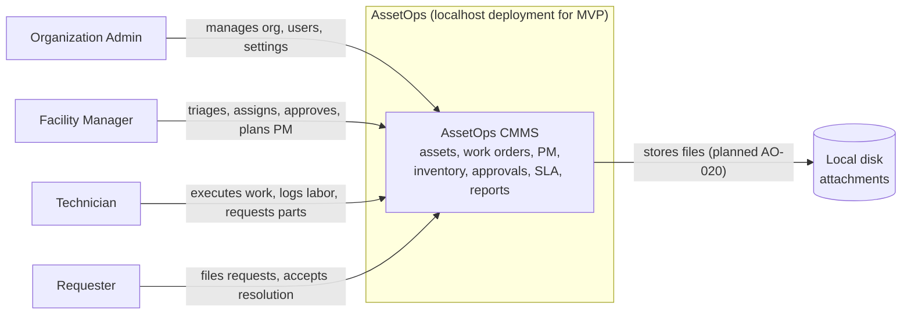
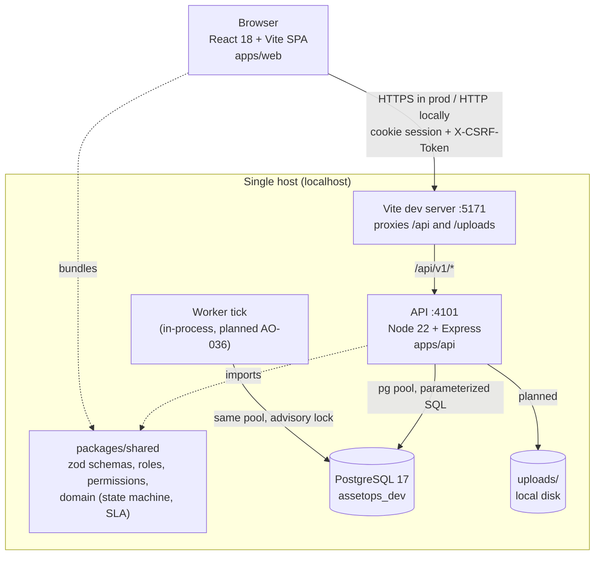
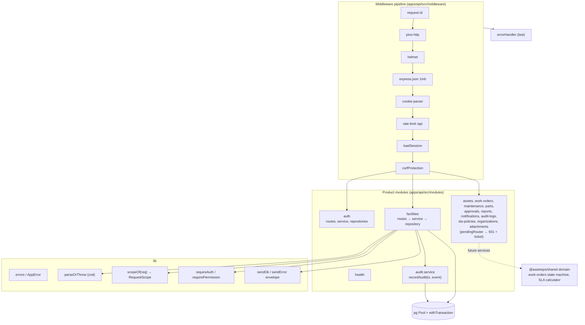

# Architecture overview

AssetOps is a multi-tenant maintenance management system (CMMS) delivered as a
**modular monolith**: one Express API process, one React single-page app, one
PostgreSQL database, and a shared TypeScript package holding validation schemas,
the permission matrix and pure domain logic. Decisions are recorded in
[docs/adr](../adr/README.md).

**Status legend:** _Implemented_ means code and tests exist in this repository.
_Planned_ means the design is agreed and tracked by a backlog ticket in
[docs/planning/backlog.md](../planning/backlog.md).

| Area                                                                      | Status                                   |
| ------------------------------------------------------------------------- | ---------------------------------------- |
| Monorepo, launcher, CI (AO-001)                                           | Implemented                              |
| Sessions, scrypt, CSRF, rate limiting (AO-002)                            | Implemented                              |
| Migrations, audit trail, health checks (AO-003)                           | Implemented                              |
| Roles and permission matrix (AO-004)                                      | Implemented                              |
| Facilities list/create/get + screen (AO-010, AO-011)                      | Implemented                              |
| Work-order state machine and SLA calculator (pure domain, AO-021, AO-022) | Implemented                              |
| Every other PRD §7 endpoint                                               | Registered, answers `501` with ticket id |
| Background worker, attachments, notifications                             | Planned (AO-036, AO-020, AO-052)         |

## C4 level 1: system context



There are no external systems at runtime: no email/SMS, no SSO, no payment or
vendor integrations (PRD §1 non-goals, §2 sandbox constraints). Notifications
are in-app only.

## C4 level 2: containers



- The web app and API share the same `zod` schemas and permission matrix from
  `@assetops/shared`, so client-side validation and server-side validation
  cannot drift (ADR-0002, ADR-0006, ADR-0007).
- The worker runs inside the API process on an interval and uses a PostgreSQL
  advisory lock so only one tick executes across processes (ADR-0012, ADR-0015).

## C4 level 3: API components



## Module boundaries

| Module        | Path                                 | Owns                                                | Status                             |
| ------------- | ------------------------------------ | --------------------------------------------------- | ---------------------------------- |
| auth          | `apps/api/src/modules/auth`          | login, logout, session, users/sessions repositories | Implemented                        |
| health        | `apps/api/src/modules/health`        | liveness, readiness                                 | Implemented                        |
| audit         | `apps/api/src/modules/audit`         | `recordAudit`; `GET /audit-logs` (AO-054)           | Writer implemented, viewer planned |
| facilities    | `apps/api/src/modules/facilities`    | facilities; areas (AO-013); archive (AO-012)        | List/create/get implemented        |
| assets        | `apps/api/src/modules/assets`        | asset registry, CSV import                          | Planned (AO-015, AO-019)           |
| work-orders   | `apps/api/src/modules/work-orders`   | orders, events, checklist, labor, part requests     | Planned (AO-023..AO-032, AO-043)   |
| maintenance   | `apps/api/src/modules/maintenance`   | templates, schedules, run-due                       | Planned (AO-037..AO-039)           |
| parts         | `apps/api/src/modules/parts`         | parts, balances, stock ledger                       | Planned (AO-041, AO-042)           |
| approvals     | `apps/api/src/modules/approvals`     | approval requests, decisions                        | Planned (AO-045, AO-046)           |
| reports       | `apps/api/src/modules/reports`       | operations report, CSV export                       | Planned (AO-049)                   |
| notifications | `apps/api/src/modules/notifications` | in-app notifications                                | Planned (AO-052)                   |
| sla           | `apps/api/src/modules/sla`           | SLA policy configuration                            | Planned (AO-033)                   |
| organizations | `apps/api/src/modules/organizations` | memberships, switching, users, settings             | Planned (AO-007, AO-055)           |
| attachments   | `apps/api/src/modules/attachments`   | upload/download                                     | Planned (AO-020)                   |
| shared domain | `packages/shared/src/domain`         | state machine (ADR-0013), SLA (ADR-0014)            | Implemented                        |

Rules enforced in review (see [CONTRIBUTING.md](../../CONTRIBUTING.md)):

1. Modules talk to each other through services, never by reading another
   module's tables directly from a repository.
2. Routes parse input with shared zod schemas, call one service method and
   return through `sendOk`. No SQL in routes.
3. Repositories accept a `Queryable` (pool or transaction client) and filter
   every statement by `organization_id`.
4. Pure domain code in `packages/shared/src/domain` has no I/O, returns new
   objects, and reports failures as typed `Result` values.

## Request lifecycle

Example: `POST /api/v1/facilities` by a Facility Manager.

```mermaid
sequenceDiagram
  autonumber
  participant B as Browser
  participant V as Vite proxy
  participant M as Middleware
  participant R as facility.routes
  participant S as facility.service
  participant P as facility.repository
  participant A as audit.service
  participant DB as PostgreSQL
  B->>V: POST /api/v1/facilities (cookie sid, X-CSRF-Token, JSON)
  V->>M: forward
  M->>M: requestId (X-Request-Id), pino-http log, helmet headers
  M->>M: rate limiter (RATE_LIMIT_MAX / window)
  M->>DB: loadSession: SELECT session by SHA-256(token)
  DB-->>M: SessionUser {id, organizationId, role}
  M->>M: csrfProtection: Origin == APP_ORIGIN, token == HMAC(session)
  M->>R: requireAuth, requirePermission('facility:create')
  R->>R: parseOrThrow(createFacilitySchema) → 422 on failure
  R->>S: create(scopeOf(req), input)
  S->>DB: BEGIN (withTransaction)
  S->>P: insert(orgId, input, actorId)
  P->>DB: INSERT ... RETURNING
  S->>A: recordAudit(tx, facility.created)
  A->>DB: INSERT audit_events
  S->>DB: COMMIT (ROLLBACK on any error; 23505 → 409)
  S-->>R: Facility
  R-->>B: 201 {success:true, data, error:null}
```

Failures at any step are converted by `errorHandler` into the error envelope
`{ success:false, data:null, error:{ code, message, details?, requestId } }`
with a stable `ErrorCode` (ADR-0006). Unknown errors are logged with the request
id and returned as a generic `INTERNAL_ERROR`.

## Cross-cutting concerns

| Concern         | Approach                                                                                                    | Status                                |
| --------------- | ----------------------------------------------------------------------------------------------------------- | ------------------------------------- |
| Tenancy         | `organization_id` on every tenant table, taken from the session; foreign ids return 404 (ADR-0003)          | Implemented for facilities            |
| Authorization   | Shared permission matrix + `requirePermission`; record-level rules in services and domain guards (ADR-0007) | Implemented                           |
| Validation      | zod at every boundary (body, query, params, env)                                                            | Implemented                           |
| Audit           | `recordAudit` inside the business transaction; table is append-only (ADR-0008)                              | Implemented                           |
| Errors          | `AppError` codes mapped to HTTP status; no stack traces to clients                                          | Implemented                           |
| Logging         | pino JSON logs with `requestId`; secrets never logged                                                       | Implemented                           |
| Configuration   | `loadEnv` validates env at boot; placeholder secret refused in production (ADR-0009)                        | Implemented                           |
| Concurrency     | Optimistic locking via `version`; conditional updates for stock; unique keys for idempotency                | Planned (AO-024, AO-042, AO-039)      |
| Background work | In-process idempotent worker tick with advisory lock (ADR-0012, ADR-0015)                                   | Planned (AO-036)                      |
| Files           | Local disk, generated names, MIME allowlist, size limit (ADR-0011)                                          | Planned (AO-020)                      |
| Time            | All instants `timestamptz` UTC; schedule dates are local dates + IANA zone                                  | Implemented for facilities            |
| Money           | Integer minor units; ratios in basis points                                                                 | Convention fixed; first use in AO-015 |

Related: [quality attributes](quality-attributes.md), [system design](../design/system-design.md),
[data model](../design/data-model.md), [threat model](../security/threat-model.md).
