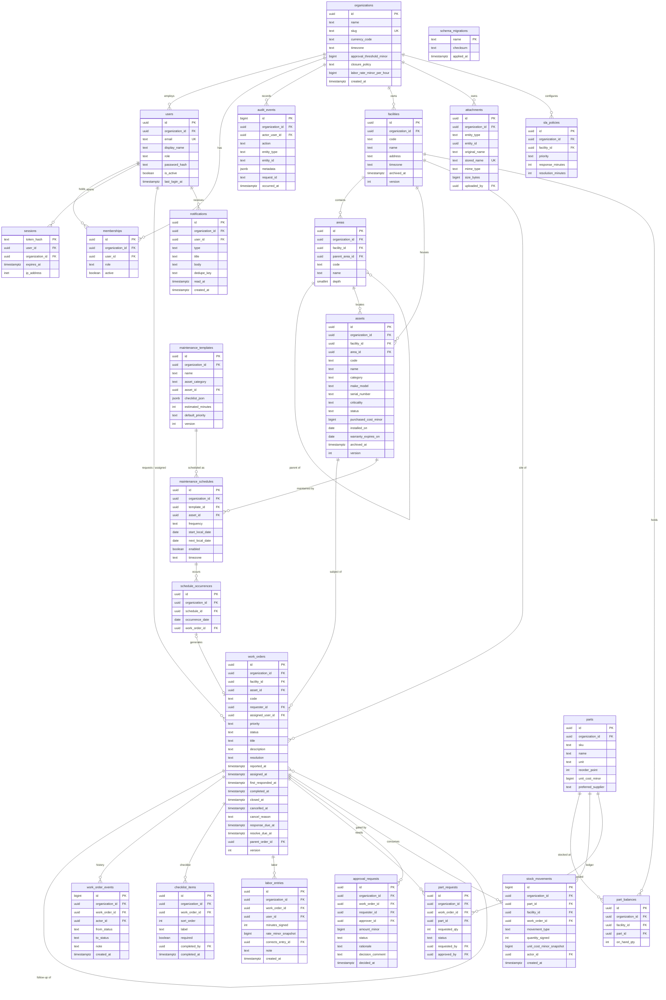

# Data model

Relational model for the full PRD §6 scope. Tables that exist today are created
by `apps/api/migrations/0001_foundation.sql` and
`apps/api/migrations/0002_roles_and_facilities.sql`; every other table is
planned and listed with its ticket in [Migration status](#migration-status).

Deliberate deviations from the PRD §6 sketch:

- **Users and organizations:** the foundation links each user to one
  organization via `users.organization_id`, with `role` on the user row. The
  PRD `memberships` table (multi-organization users, role per membership)
  replaces this in **AO-007**; sessions then carry the active organization.
- **Audit:** the PRD `audit_logs` table is implemented as `audit_events`
  (`metadata` jsonb holds the before/after summary, plus `request_id`).
- **Email:** `users.email` is stored lower-cased with a `CHECK`, which is the
  PRD's `email_normalized`.

## Entity relationship diagram

`sla_policies` is not in the PRD §6 list but is required by FR-05
("configurable targets by priority and optionally site").

## Conventions

### Tenancy

- Every tenant-owned table has `organization_id uuid NOT NULL` referencing
  `organizations(id)`; the value always comes from the session (ADR-0003).
- Parents expose `UNIQUE (organization_id, id)` (already on `users` and
  `facilities` in migration 0002). Children reference the pair, e.g.
  `FOREIGN KEY (organization_id, facility_id) REFERENCES facilities (organization_id, id)`,
  so the database rejects a row in organization A pointing at a parent in
  organization B, independently of application checks.
- Indexes lead with `organization_id`.

### Money

- All amounts are `bigint` **integer minor units** (cents) with a `_minor`
  suffix; the currency is `organizations.currency_code` (ISO 4217).
- Ratios and percentages are integer **basis points** (`_bp`, 10000 = 100 %),
  e.g. SLA at-risk threshold 8000.
- Unit costs and labor rates are **snapshotted** onto ledger and labor rows so
  historical costs never change when a catalogue price changes.
- Cost formula (FR-09, AO-048): `labor_minutes × rate_minor_per_hour / 60` +
  `Σ(issued qty × unit_cost_minor_snapshot)`, rounded half-up to the minor unit;
  a missing rate yields an explicit "incomplete" flag, never zero.

### Time

- Instants are `timestamptz` and handled as UTC (`reported_at`,
  `first_responded_at`, due times, audit `occurred_at`).
- Facilities and schedules carry an IANA `timezone`; schedule dates
  (`start_local_date`, `next_local_date`, `occurrence_date`) are `date` values in
  that zone so daylight-saving changes do not shift due days.
- SLA budgets are elapsed clock minutes (ADR-0014).

### Integrity

- Status/enum columns use `CHECK (... IN (...))` matching the shared TypeScript
  constants.
- Mutable aggregates carry `version int` for optimistic locking.
- Soft deletion through `archived_at`; financial and history tables are never
  deleted.
- Append-only tables (`audit_events`, `work_order_events`, `stock_movements`,
  `labor_entries`) have no update paths in code; the production database role
  is granted `INSERT, SELECT` only on them.

## Per-table notes

| Table                 | Key constraints                                                                                                               | Indexes                                                                                                                                                                                 | Notes                                                                                        |
| --------------------- | ----------------------------------------------------------------------------------------------------------------------------- | --------------------------------------------------------------------------------------------------------------------------------------------------------------------------------------- | -------------------------------------------------------------------------------------------- |
| organizations         | `slug` unique, `^[a-z0-9-]{2,64}$`; name 1–200                                                                                | PK, slug                                                                                                                                                                                | Settings columns (currency, timezone, threshold, closure policy, labor rate) added in AO-055 |
| users                 | `email` unique and lower-case; `role` CHECK in four roles (0002); `UNIQUE (organization_id, id)` (0002)                       | `users_org_idx`                                                                                                                                                                         | Moves to memberships in AO-007                                                               |
| memberships           | `UNIQUE (organization_id, user_id)`; `role` CHECK                                                                             | `(user_id) WHERE active`                                                                                                                                                                | AO-007                                                                                       |
| sessions              | PK `token_hash` (SHA-256 of token)                                                                                            | user, expires_at                                                                                                                                                                        | Purged by worker                                                                             |
| audit_events          | append-only                                                                                                                   | `(organization_id, occurred_at DESC)`, `(entity_type, entity_id)`                                                                                                                       | Same transaction as change (ADR-0008)                                                        |
| schema_migrations     | PK name, checksum                                                                                                             | —                                                                                                                                                                                       | Runner refuses edited migrations                                                             |
| facilities            | `UNIQUE (organization_id, code)`; code `^[A-Z0-9][A-Z0-9-]{1,19}$`; `UNIQUE (organization_id, id)`; `version > 0`             | `(organization_id, name, id)`, partial `(organization_id) WHERE archived_at IS NULL`                                                                                                    | Implemented (0002)                                                                           |
| areas                 | `UNIQUE (facility_id, code)`; `depth BETWEEN 1 AND 3`; composite FK to facilities                                             | `(organization_id, facility_id)`                                                                                                                                                        | AO-013                                                                                       |
| assets                | `UNIQUE (organization_id, code)`; `purchased_cost_minor >= 0`; criticality/status CHECK                                       | `(organization_id, facility_id)`, `(organization_id, status)`, `(organization_id, criticality)`, trigram on code/name/serial                                                            | AO-015                                                                                       |
| work_orders           | `UNIQUE (organization_id, code)`; status/priority CHECK; `version`                                                            | `(organization_id, status)`, `(organization_id, facility_id)`, `(organization_id, assigned_user_id, status)`, `(organization_id, response_due_at)`, `(organization_id, resolve_due_at)` | AO-023                                                                                       |
| work_order_events     | append-only                                                                                                                   | `(work_order_id, created_at)`                                                                                                                                                           | AO-024                                                                                       |
| checklist_items       | `UNIQUE (work_order_id, sort_order)`                                                                                          | `(work_order_id)`                                                                                                                                                                       | Snapshot from template (AO-026)                                                              |
| labor_entries         | `minutes_signed <> 0`; corrections reference original                                                                         | `(organization_id, work_order_id)`, `(organization_id, user_id, created_at)`                                                                                                            | AO-027                                                                                       |
| maintenance_templates | `estimated_minutes > 0`; `version`                                                                                            | `(organization_id)`                                                                                                                                                                     | AO-037                                                                                       |
| maintenance_schedules | frequency CHECK (`DAILY`,`WEEKLY`,`MONTHLY`)                                                                                  | `(organization_id, next_local_date) WHERE enabled`                                                                                                                                      | AO-038                                                                                       |
| schedule_occurrences  | **`UNIQUE (schedule_id, occurrence_date)`**                                                                                   | —                                                                                                                                                                                       | Idempotent generation (AO-039, A-09)                                                         |
| parts                 | `UNIQUE (organization_id, sku)`; `unit_cost_minor >= 0`                                                                       | `(organization_id, name)`                                                                                                                                                               | AO-041                                                                                       |
| part_balances         | `UNIQUE (facility_id, part_id)`; `CHECK (on_hand_qty >= 0)`                                                                   | `(organization_id, facility_id)`                                                                                                                                                        | AO-041                                                                                       |
| stock_movements       | movement_type CHECK; sign consistent with type                                                                                | `(organization_id, part_id, created_at)`, `(work_order_id)`                                                                                                                             | Append-only ledger (AO-042)                                                                  |
| part_requests         | status CHECK; `requested_qty > 0`                                                                                             | `(organization_id, status)`                                                                                                                                                             | AO-043                                                                                       |
| approval_requests     | `amount_minor > 0`; `approver_id <> requester_id`; partial unique `(organization_id, work_order_id) WHERE status = 'PENDING'` | `(organization_id, status)`                                                                                                                                                             | AO-046                                                                                       |
| sla_policies          | `UNIQUE NULLS NOT DISTINCT (organization_id, facility_id, priority)`; `resolution_minutes >= response_minutes > 0`            | —                                                                                                                                                                                       | AO-033                                                                                       |
| attachments           | `stored_name` unique; size ≤ limit; MIME allowlist                                                                            | `(organization_id, entity_type, entity_id)`                                                                                                                                             | AO-020                                                                                       |
| notifications         | `UNIQUE (organization_id, dedupe_key)` when not null                                                                          | `(user_id, read_at, created_at DESC)`                                                                                                                                                   | AO-052                                                                                       |

## Migration status

| Table                                       | Status  | Migration / ticket                                     |
| ------------------------------------------- | ------- | ------------------------------------------------------ |
| organizations                               | Exists  | 0001 (settings columns: AO-055)                        |
| users                                       | Exists  | 0001; role CHECK + `(organization_id, id)` key in 0002 |
| sessions                                    | Exists  | 0001                                                   |
| audit_events                                | Exists  | 0001                                                   |
| schema_migrations                           | Exists  | migration runner                                       |
| facilities                                  | Exists  | 0002                                                   |
| memberships                                 | Pending | AO-007                                                 |
| areas                                       | Pending | AO-013                                                 |
| site access grants                          | Pending | AO-014                                                 |
| assets                                      | Pending | AO-015                                                 |
| attachments                                 | Pending | AO-020                                                 |
| work_orders, work_order_events              | Pending | AO-023, AO-024                                         |
| checklist_items                             | Pending | AO-026                                                 |
| labor_entries                               | Pending | AO-027                                                 |
| sla_policies                                | Pending | AO-033                                                 |
| maintenance_templates                       | Pending | AO-037                                                 |
| maintenance_schedules, schedule_occurrences | Pending | AO-038, AO-039                                         |
| parts, part_balances                        | Pending | AO-041                                                 |
| stock_movements                             | Pending | AO-042                                                 |
| part_requests                               | Pending | AO-043                                                 |
| approval_requests                           | Pending | AO-046                                                 |
| notifications                               | Pending | AO-052                                                 |

New tables arrive as new numbered migrations (`0003_…`); applied migrations are
never edited (ADR-0004).
