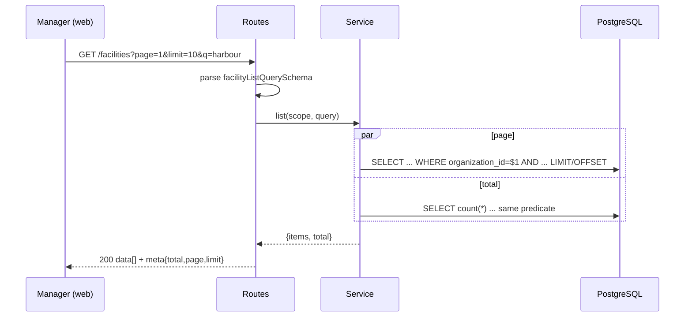
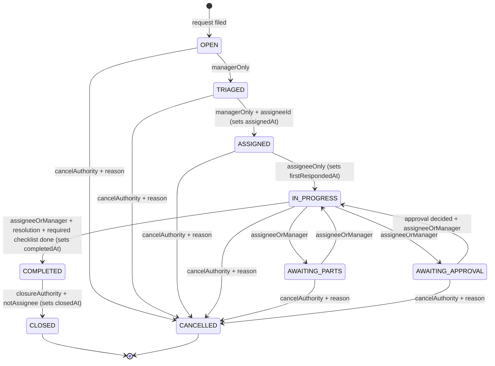
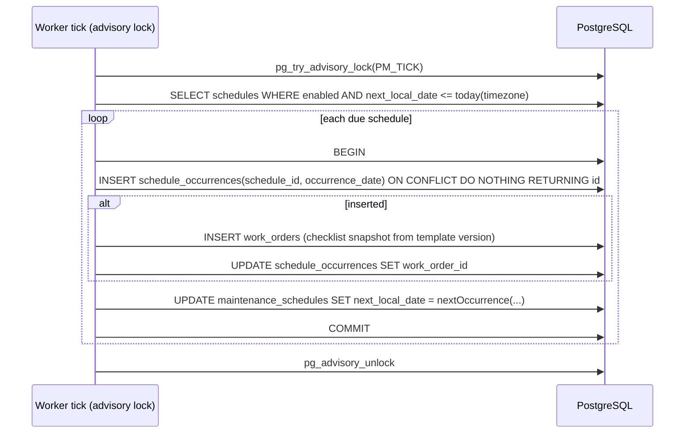
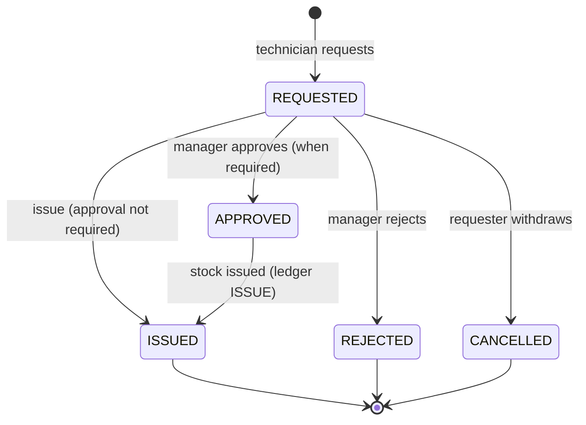
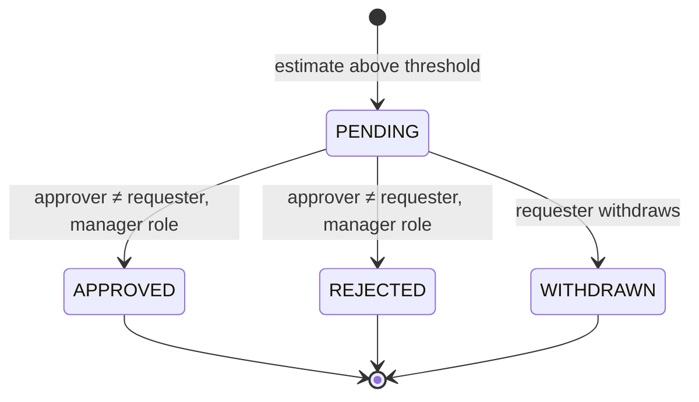

# System design

Module-by-module design for AssetOps. Each section states what is
**implemented** today and what is **planned** (with its backlog ticket). The
container and component views are in [architecture/overview.md](../architecture/overview.md);
tables are in [data-model.md](data-model.md).

## 1. Module summary

| Module        | Responsibility                                      | Status                                  | Tickets                |
| ------------- | --------------------------------------------------- | --------------------------------------- | ---------------------- |
| auth          | Sign-in, sessions, CSRF token issue, logout         | Implemented                             | AO-002                 |
| organizations | Memberships, active organization, users, settings   | Planned                                 | AO-007, AO-055         |
| facilities    | Facility registry, area hierarchy, site access      | List/create/get implemented             | AO-010, AO-012..AO-014 |
| assets        | Asset registry, history, CSV import                 | Planned                                 | AO-015..AO-019         |
| attachments   | Local file storage                                  | Planned                                 | AO-020                 |
| work-orders   | Lifecycle, assignment, checklist, labor, follow-ups | Domain implemented, persistence planned | AO-021, AO-023..AO-032 |
| sla           | Policies, due dates, evaluation, escalation         | Domain implemented, persistence planned | AO-022, AO-033, AO-034 |
| maintenance   | Templates, schedules, idempotent generation         | Planned                                 | AO-036..AO-040         |
| parts         | Catalogue, balances, stock ledger, part requests    | Planned                                 | AO-041..AO-044         |
| approvals     | Repair approval policy and decisions                | Planned                                 | AO-045..AO-047         |
| reports       | Cost model, dashboard, reports, CSV export          | Planned                                 | AO-048..AO-051         |
| notifications | In-app notifications                                | Planned                                 | AO-052, AO-053         |
| audit         | Append-only writer, read-only viewer                | Writer implemented, viewer planned      | AO-003, AO-054         |

## 2. Facilities (implemented)

Layers: `facility.routes.ts` → `facility.service.ts` → `facility.repository.ts`.

- **List** `GET /api/v1/facilities?page&limit&q&includeArchived`: all roles
  (`facility:read`). Search matches code or name with `ILIKE`; user text is
  escaped with `toLikePattern` so `%` and `_` match literally. Ordered by
  `(name, id)`; a separate `count(*)` on the same predicate fills `meta.total`.
- **Create** `POST /api/v1/facilities`: `facility:create` (Org Admin, Facility
  Manager). Input normalised by `createFacilitySchema` (code upper-cased,
  IANA time zone verified with `Intl.DateTimeFormat`). Insert and
  `facility.created` audit row share one transaction. Unique violation on
  `(organization_id, code)` maps to `409 CONFLICT`.
- **Get** `GET /api/v1/facilities/:id`: malformed ids and ids belonging to
  other organizations both return `404`, so probing reveals nothing.
- **Pending:** `PATCH /:id` (AO-012, optimistic lock + archive guard),
  `/:id/areas` (AO-013), per-site access grants (AO-014, marked
  `TODO(AO-014)` in the service).



## 3. Work orders

### 3.1 State machine (implemented in `packages/shared/src/domain/work-orders`)

`transition(order, request, context)` returns either
`{ ok: true, value: { order, event } }` with a **new** order (`version + 1`)
and the event to persist, or `{ ok: false, error: { code, message, details } }`.
`canTransition` runs the same checks without producing state. See ADR-0013.



Guard definitions (`guards.ts`):

| Guard                      | Passes when                                                                                 | Error code                                  |
| -------------------------- | ------------------------------------------------------------------------------------------- | ------------------------------------------- |
| `managerOnly`              | actor role is `ORG_ADMIN` or `FACILITY_MANAGER`                                             | `ROLE_NOT_PERMITTED`                        |
| `assigneeOnly`             | actor is the order's assignee                                                               | `NOT_ASSIGNEE`                              |
| `assigneeOrManager`        | manager role, else `assigneeOnly`                                                           | `NOT_ASSIGNEE`                              |
| `requireAssignee`          | non-blank `assigneeId` in request                                                           | `ASSIGNEE_REQUIRED`                         |
| `requireResolution`        | non-blank resolution in request or stored on order                                          | `RESOLUTION_REQUIRED`                       |
| `requireChecklistComplete` | every `required` item has `completedAt` (A-05)                                              | `CHECKLIST_INCOMPLETE` (+ `missingItemIds`) |
| `requireApprovalDecision`  | `context.approvalDecision` is `APPROVED` or `REJECTED` (A-08)                               | `APPROVAL_REQUIRED`                         |
| `closureAuthority`         | `MANAGER_VERIFICATION`: manager role; `REQUESTER_ACCEPTANCE`: the requester or an org admin | `ROLE_NOT_PERMITTED`                        |
| `notAssignee`              | actor did not perform the work (no self-approval)                                           | `SELF_APPROVAL`                             |
| `cancelAuthority`          | manager role, or the requester withdrawing their own `OPEN` request                         | `ROLE_NOT_PERMITTED`                        |
| `requireReason`            | non-blank cancellation reason                                                               | `REASON_REQUIRED`                           |

Checks are evaluated in this order: terminal status (`ORDER_LOCKED`), edge
exists (`INVALID_TRANSITION`, same-status included), then the edge's guards
left to right. `ensureEditable(order)` returns `ORDER_LOCKED` for `CLOSED` and
`CANCELLED`, and is the single check used by checklist, labor and cost edits so
nothing changes after closure (FR-03, PRD §3). Reopening creates a linked
follow-up order (AO-032).

### 3.2 Persistence (planned AO-023, AO-024)

```mermaid
sequenceDiagram
  participant T as Technician
  participant R as work-orders routes
  participant S as service
  participant D as domain.transition
  participant DB as PostgreSQL
  T->>R: POST /work-orders/:id/transition {to, version, resolution}
  R->>S: transition(scope, id, body)
  S->>DB: BEGIN
  S->>DB: SELECT order + checklist + active approval WHERE organization_id=$1 AND id=$2
  S->>D: transition(state, request, {closurePolicy, approvalDecision})
  alt domain error
    D-->>S: {ok:false, code}
    S->>DB: ROLLBACK
    S-->>T: 409 INVALID_STATE_TRANSITION / 403 (details.code)
  else ok
    D-->>S: {order, event}
    S->>DB: UPDATE work_orders SET ... version=version+1 WHERE id=$ AND version=$expected
    alt 0 rows
      S->>DB: ROLLBACK
      S-->>T: 409 CONFLICT (stale version)
    else 1 row
      S->>DB: INSERT work_order_events; INSERT audit_events
      S->>DB: COMMIT
      S-->>T: 200 updated order
    end
  end
```

Work-order codes are sequential per organization (`WO-000123`) from a
per-organization counter row updated with `UPDATE ... RETURNING` inside the
create transaction, protected by `UNIQUE (organization_id, code)`.

## 4. SLA engine

### 4.1 Calculator (implemented in `packages/shared/src/domain/sla`, ADR-0014)

- `resolveSlaTarget(policies, priority, facilityId)`: site-specific policy
  wins; otherwise the organization default (`facilityId = null`); another
  site's policy is never used as a fallback. Missing → `POLICY_NOT_FOUND`.
- `computeSlaDueDates(reportedAt, target)`: `reportedAt + minutes` in elapsed
  clock time (no business hours in MVP). Targets must be positive whole minutes
  with `resolution ≥ response`.
- `evaluateSla(timestamps, due, now, { atRiskBp = 8000 })` evaluates two clocks:

| Clock      | Starts        | Stops                                                                                                                     | Not applicable        |
| ---------- | ------------- | ------------------------------------------------------------------------------------------------------------------------- | --------------------- |
| Response   | `reported_at` | `first_responded_at` (first accepted technician action, set on `ASSIGNED → IN_PROGRESS`; assignment does **not** stop it) | cancelled before stop |
| Resolution | `reported_at` | `completed_at` (closure happens later and does not affect it)                                                             | cancelled before stop |

State per clock: `MET` / `BREACHED` once stopped (`stoppedAt ≤ dueAt` is met);
otherwise `BREACHED` strictly after `dueAt`, `AT_RISK` when consumed share
`≥ atRiskBp` basis points, else `PENDING`. Consumed share is
`floor(elapsed × 10000 / budget)` using integer milliseconds.

- `pendingEscalations(workOrderId, evaluation, alreadySent)`: emits
  `AT_RISK` and `BREACHED` escalations per clock with dedupe key
  `"<workOrderId>:<CLOCK>:<LEVEL>"`, excluding keys already sent and clocks
  that stopped late.

### 4.2 Escalation worker (planned AO-034)

Each worker tick selects open orders whose response or resolution clock is
running, evaluates them, and inserts notifications with
`INSERT ... ON CONFLICT (organization_id, dedupe_key) DO NOTHING`, giving
exactly one alert per level even across restarts or concurrent ticks (A-10).

## 5. Preventive maintenance (planned AO-036..AO-040, ADR-0015)



- `UNIQUE (schedule_id, occurrence_date)` makes generation idempotent; running
  the tick or `POST /maintenance/run-due` twice yields one order per
  occurrence (A-09).
- Recurrence is a pure function over local dates in the schedule's IANA time
  zone; monthly on day 29–31 clamps to the last day of shorter months (AO-038).
- Generated orders store a checklist snapshot, so template edits only affect
  future work (FR-06).

## 6. Inventory and stock ledger (planned AO-041..AO-044, ADR-0016)

Every change is a `stock_movements` row (`RECEIPT`, `ISSUE`, `RETURN`,
`ADJUSTMENT`) with signed quantity and captured unit cost. `part_balances`
holds the running on-hand quantity per `(facility_id, part_id)`.

Issue to a work order (A-06, A-07), all in one transaction:

```sql
UPDATE part_balances
   SET on_hand_qty = on_hand_qty - $qty
 WHERE organization_id = $org AND facility_id = $facility AND part_id = $part
   AND on_hand_qty >= $qty
RETURNING on_hand_qty;
-- 0 rows → 409 CONFLICT (details.reason = INSUFFICIENT_STOCK), rollback; 1 row → insert ISSUE movement + audit
```

The conditional `UPDATE` takes a row lock, so two concurrent issues of 2 from
a balance of 3 serialize: exactly one succeeds and stock never goes negative.
A `CHECK (on_hand_qty >= 0)` is the database backstop. Ledger rows are never
updated or deleted; corrections are new `ADJUSTMENT` rows.

Part request states:



Stock is consumed on issue only, never on request (FR-07).

## 7. Repair approvals (planned AO-045..AO-047, ADR-0017)

- Approval is required when `amount_minor > organizations.approval_threshold_minor`.
- The requester can never decide their own request; a partial unique index on
  `(organization_id, work_order_id) WHERE status = 'PENDING'` prevents
  duplicate active approvals.
- While a request is pending the order sits in `AWAITING_APPROVAL`; the state
  machine refuses to resume without a decision (A-08).



Decisions are audited and notify the requester; rejected requests remain
visible.

## 8. Background jobs

| Job                   | Cadence                   | Idempotency                             | Ticket |
| --------------------- | ------------------------- | --------------------------------------- | ------ |
| SLA escalation scan   | 60 s                      | unique notification dedupe key          | AO-034 |
| PM generation         | 60 s (+ manual `run-due`) | unique `(schedule_id, occurrence_date)` | AO-039 |
| Low-stock alerts      | 5 min                     | dedupe key per part/facility/day        | AO-044 |
| Expired session purge | 1 h                       | `DELETE ... WHERE expires_at <= now()`  | AO-036 |

The worker runs in the API process (no external cron), takes a PostgreSQL
advisory lock per job so multiple API replicas never double-run, and logs
duration and outcome per tick (ADR-0012).

## 9. File storage (planned AO-020, ADR-0011)

Uploads are streamed to `UPLOAD_DIR` under a random 128-bit name; the original
name is kept only as metadata. MIME type is checked against an allowlist
(images, PDF, CSV) by magic bytes, size limited by `UPLOAD_MAX_BYTES`
(10 MB default), resolved paths must stay inside `UPLOAD_DIR`, and downloads
check that the attachment's `organization_id` matches the session.

## 10. Notifications (planned AO-052, ADR-0012)

Notifications are rows per recipient with `read_at`. Producers (assignment,
SLA, approvals, low stock) insert within the triggering transaction or the
worker tick with a dedupe key. The web client polls the unread count every
30 s; no external delivery channels exist in the MVP.

## 11. Concurrency and idempotency

| Risk                                    | Mechanism                                                                                        |
| --------------------------------------- | ------------------------------------------------------------------------------------------------ |
| Lost update on work orders / facilities | `version` column; `UPDATE ... WHERE version = $expected`; 0 rows → 409                           |
| Over-issuing stock                      | Conditional decrement + `CHECK (on_hand_qty >= 0)`                                               |
| Duplicate PM orders                     | `UNIQUE (schedule_id, occurrence_date)` + `ON CONFLICT DO NOTHING`                               |
| Duplicate alerts                        | Unique dedupe key per notification                                                               |
| Duplicate active approvals              | Partial unique index on pending approvals                                                        |
| Duplicate codes                         | `UNIQUE (organization_id, code)` on facilities, assets, work orders; SKU unique per organization |
| Cross-tenant references                 | Composite FKs to `(organization_id, id)`                                                         |

## 12. Error handling

- Services throw `AppError` with a stable `ErrorCode`; domain functions return
  `Result` values that services map: `INVALID_TRANSITION`/`ORDER_LOCKED`/gate
  failures → `409 INVALID_STATE_TRANSITION` with `details.code`; actor failures
  (`ROLE_NOT_PERMITTED`, `NOT_ASSIGNEE`, `SELF_APPROVAL`) → `403 FORBIDDEN`.
- zod failures → `422 VALIDATION_FAILED` with `[{ path, message }]`.
- Unknown errors → `500 INTERNAL_ERROR`, logged with `requestId`, no internals
  in the body.
- Pending endpoints → `501 NOT_IMPLEMENTED` with `details.ticket`.

## 13. Performance and indexing strategy

- Every tenant index leads with `organization_id`, matching the always-present
  tenant predicate: `(organization_id, status)`, `(organization_id, facility_id)`,
  `(organization_id, assigned_user_id, status)`, `(organization_id, resolve_due_at)`
  for overdue queues, `(organization_id, occurred_at DESC)` for audit.
- Partial indexes for hot subsets: active facilities, open work orders,
  pending approvals.
- List endpoints cap `limit` at 100; reports aggregate in SQL, not in Node.
- Domain logic is pure and synchronous, so it adds microseconds per request.

## 14. Future scaling path

1. Run multiple API replicas behind a reverse proxy; sessions and locks
   already live in PostgreSQL.
2. Move the worker to a dedicated process using the same code and advisory locks.
3. Keyset pagination and monthly partitions for `work_order_events`,
   `stock_movements` and `audit_events`.
4. Read replica for reports and CSV export.
5. Object storage behind the attachment interface instead of local disk.
6. Row-level security policies as defence in depth on top of repository scoping.
