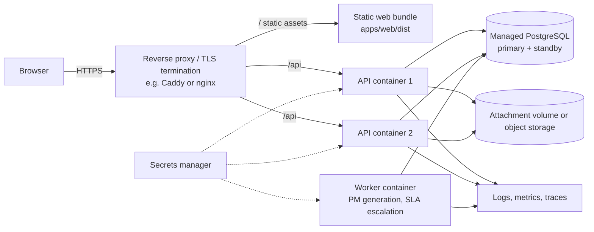

# Deployment (planned)

> **Status: plan only.** The MVP targets local operation (PRD §2). Nothing in this document is
> implemented yet; it records the intended production topology so that current decisions stay
> compatible with it. Production observability and backups are post-MVP items (PRD §12).

## Target topology

## Components

| Component       | Plan                                                                                                                                                                                           |
| --------------- | ---------------------------------------------------------------------------------------------------------------------------------------------------------------------------------------------- |
| Container image | Multi-stage build: `npm ci`, `npm run build`, copy `apps/api/dist`, `apps/api/migrations` and production dependencies into `node:22-slim`; run as non-root; read-only root filesystem.         |
| Web             | Serve `apps/web/dist` from the proxy or a CDN with long-lived cache headers and a strict CSP.                                                                                                  |
| Reverse proxy   | TLS 1.2+ with automatic certificates, HSTS, HTTP→HTTPS redirect, request size limits; forwards `X-Forwarded-*` (API already trusts loopback proxies).                                          |
| Database        | Managed PostgreSQL 17 with automated backups, point-in-time recovery and a standby. App connects with a role that has no `UPDATE`/`DELETE` on `audit_events`.                                  |
| Secrets         | `SESSION_SECRET` and `DATABASE_URL` from the platform secrets manager; never baked into images. The API refuses the placeholder secret in production.                                          |
| Migrations      | Run once per release as a CD job (`node dist/cli.js migrate`) before new containers receive traffic. Forward-only, so rollbacks deploy a fix-forward migration.                                |
| Zero downtime   | Rolling deploy behind health checks: `/api/health/ready` gates traffic, `/api/health/live` drives restarts. Migrations stay backward compatible for one release (expand → migrate → contract). |
| Worker          | Separate process running the tick loop (ADR-0012, ADR-0015) with an advisory lock so only one instance generates work.                                                                         |
| Attachments     | Shared volume initially; object storage with signed URLs when scaling horizontally (ADR-0011).                                                                                                 |
| Observability   | pino JSON logs shipped to a central store keyed by `requestId`; RED metrics per route; alert on readiness failures, 5xx rate and worker lag.                                                   |
| Backups         | Daily full plus WAL archiving (RPO ≤ 15 min, RTO ≤ 4 h, see quality attributes); quarterly restore drill.                                                                                      |

## Production checklist (before first deploy)

- [ ] `NODE_ENV=production`, unique `SESSION_SECRET`, secure cookies (automatic in production).
- [ ] Seed never run; demo accounts absent.
- [ ] Audit table privileges restricted.
- [ ] Rate limits tuned; CSP and HSTS enabled.
- [ ] Backups verified by a test restore.
- [ ] AO-060 security review complete.
