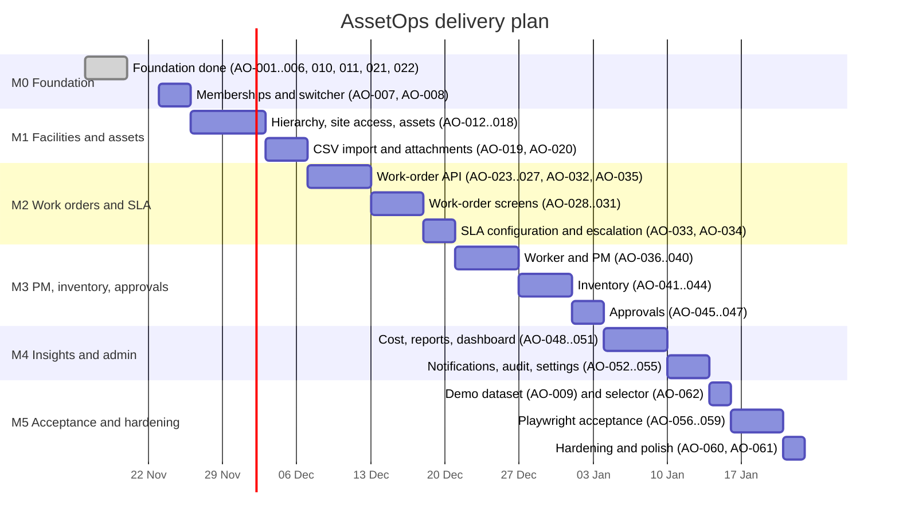

# Roadmap

AssetOps is delivered in six milestones. Estimates are focused engineering hours taken from
[backlog.md](backlog.md); calendar dates assume one engineer at roughly 25 focused hours per week
and start on **2026-11-23**. Dates are planning targets, not commitments.

## Status at a glance

| Milestone                       | Goal                                                                     | Estimate (h) | Done (h) | Status                                                        |
| ------------------------------- | ------------------------------------------------------------------------ | -----------: | -------: | ------------------------------------------------------------- |
| M0: Foundation                  | Runnable, secure, multi-tenant skeleton with real roles                  |           29 |       16 | ⏳ In progress (AO-007, AO-008, AO-009 open)                  |
| M1: Facilities and assets       | Facility hierarchy, site access, asset registry, attachments, CSV import |           46 |        7 | ⏳ In progress (facilities slice done)                        |
| M2: Work orders and SLA         | Full corrective lifecycle, technician execution, SLA engine              |           53 |        7 | ⏳ In progress (domain state machine and SLA calculator done) |
| M3: PM, inventory, approvals    | Worker, PM generation, stock ledger, approvals                           |           44 |        0 | ⏳ Not started                                                |
| M4: Insights and administration | Cost model, dashboard, reports, notifications, audit viewer, settings    |           30 |        0 | ⏳ Not started                                                |
| M5: Acceptance and hardening    | PRD §9 Playwright suite, security review, accessibility                  |           27 |        0 | ⏳ Not started                                                |
| **Total**                       |                                                                          |      **229** |   **30** | **13.1 % complete**                                           |

## Milestones

### M0: Foundation

- **Goal:** a fresh clone reaches a running, authenticated, tenant-isolated app with `./run.sh`.
- **Delivered:** monorepo and CI (AO-001), session auth with CSRF and rate limiting (AO-002),
  migrations, audit and health (AO-003), AssetOps roles and permission matrix (AO-004),
  development seed (AO-005), documentation set (AO-006).
- **Remaining:** multi-organization memberships (AO-007), organization/site switcher (AO-008),
  full PRD §8 dataset (AO-009, scheduled last because it depends on M1-M3 tables).
- **Exit criteria:** users with several memberships can switch organization; every query is scoped
  to the session organization; demo dataset loads with `./run.sh reset --yes`.

### M1: Facilities and assets

- **Goal:** a complete, searchable asset registry organised by site and area.
- **Delivered:** facilities list/create/get API and screen (AO-010, AO-011).
- **Remaining:** facility update/archive (AO-012), hierarchy (AO-013), site grants (AO-014),
  asset API and screens (AO-015 to AO-018), CSV import (AO-019), attachments (AO-020).
- **Exit criteria:** A-02, A-12 and A-14 pass at API level; asset history derives from records.

### M2: Work orders and SLA

- **Goal:** the corrective-maintenance workflow works end to end with SLA tracking.
- **Delivered:** pure work-order state machine (AO-021) and SLA calculator (AO-022), both at 100 %
  branch coverage.
- **Remaining:** persistence and endpoints (AO-023 to AO-027, AO-032, AO-035), screens (AO-028 to
  AO-031), SLA configuration and escalations (AO-033, AO-034).
- **Exit criteria:** A-03, A-04, A-05 and A-10 pass at API level; concurrent transitions are safe.

### M3: Preventive maintenance, inventory and approvals

- **Goal:** scheduled work, parts consumption and spend control preserve integrity under retries.
- **Scope:** worker (AO-036), templates/schedules/generation (AO-037 to AO-040), parts and ledger
  (AO-041 to AO-044), approvals (AO-045 to AO-047).
- **Exit criteria:** A-06, A-07, A-08 and A-09 pass, including the concurrency test.

### M4: Insights, notifications and administration

- **Goal:** managers see live operational data and administrators control the organization.
- **Scope:** cost computation (AO-048), reports and export (AO-049, AO-051), dashboard (AO-050),
  notifications (AO-052, AO-053), audit viewer (AO-054), users and settings (AO-055).
- **Exit criteria:** A-11 and A-15 pass; no KPI is hard-coded.

### M5: Acceptance and hardening

- **Goal:** every PRD §9 scenario is automated and the app meets the definition of done (PRD §11).
- **Scope:** Playwright suites (AO-056 to AO-059), security review (AO-060), accessibility and
  polish (AO-061), demo-account selector (AO-062).
- **Exit criteria:** A-01 to A-15 green in CI; ASVS L2 checklist reviewed; WCAG 2.1 AA on core screens.

## Timeline

## Out of scope for the MVP

As listed in PRD §12: external email/SMS, customer/vendor portals, barcode/QR scanning, mobile
offline sync, IoT monitoring, purchasing integrations, business-hour SLA calendars, depreciation,
predictive maintenance, SSO, billing and production observability/backups. The production topology
is sketched in [../operations/deployment.md](../operations/deployment.md) as a plan only.
