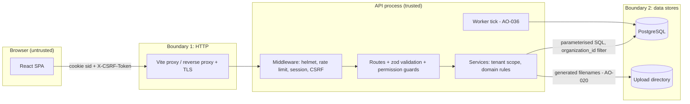

# Threat model

Scope: the AssetOps MVP as a local, multi-tenant web application (React SPA, Express API,
PostgreSQL, local-disk attachments, in-process worker). Method: STRIDE per component, reviewed
whenever a ticket changes a trust boundary. Status reflects the code today; pending mitigations
name the backlog ticket that delivers them.

## Assets

| Asset                                                                   | Why it matters                                                              |
| ----------------------------------------------------------------------- | --------------------------------------------------------------------------- |
| Tenant operational data (facilities, assets, work orders, labor)        | Core business records; cross-tenant leakage is the top risk (PRD outcome 6) |
| Financial data (part unit costs, repair estimates, approval thresholds) | Confidential pricing hidden from technicians and requesters (PRD §3)        |
| Approval decisions and stock ledger                                     | Integrity of spend and inventory; must be tamper-evident                    |
| Audit trail                                                             | Evidence for disputes and incident response; append-only                    |
| Credentials and session tokens                                          | Account takeover enables every other attack                                 |
| Attachments on disk                                                     | Arbitrary uploads can carry malware or path-traversal payloads              |
| Availability of the API and database                                    | Technicians depend on it during incidents                                   |

## Actors

| Actor                             | Trust                  | Notes                                                     |
| --------------------------------- | ---------------------- | --------------------------------------------------------- |
| Anonymous internet user           | Untrusted              | Can reach `/api/auth/login` and health probes only        |
| Requester                         | Low                    | Files requests, sees own work orders                      |
| Technician                        | Medium                 | Executes assigned work; no pricing, no approvals          |
| Facility Manager                  | High within org        | Manages operations, approves spend; no security settings  |
| Organization Admin                | Highest within org     | Users, roles, settings; never across organizations        |
| Malicious tenant member           | Authenticated, hostile | Tries to read or modify another organization's data       |
| Operator (deploys, has DB access) | Trusted                | Out of scope for app controls; covered by deployment plan |

## Trust boundaries

Boundary 1 separates untrusted input from the API; every byte crossing it is validated.
Boundary 2 separates application logic from storage; the API is the only writer.

## STRIDE analysis

| Component        | Threat (STRIDE)         | Scenario                                                           | Mitigation                                                                                                 | Status                                                                          |
| ---------------- | ----------------------- | ------------------------------------------------------------------ | ---------------------------------------------------------------------------------------------------------- | ------------------------------------------------------------------------------- |
| Auth             | Spoofing                | Credential stuffing / brute force                                  | scrypt hashes with unique salt; login rate limit; generic failure message; dummy hash on unknown email     | Implemented (AO-002)                                                            |
| Auth             | Spoofing                | Session theft via script                                           | HTTP-only, SameSite=Lax cookie; `Secure` in production; tokens stored only as SHA-256 hashes               | Implemented (AO-002)                                                            |
| Auth             | Tampering               | CSRF on state-changing routes                                      | Origin/Referer check against `APP_ORIGIN` plus HMAC `X-CSRF-Token` bound to the session                    | Implemented (AO-002)                                                            |
| Auth             | Elevation               | User switches into an organization without membership              | Server-side membership check on switch                                                                     | Pending (AO-007)                                                                |
| Facilities API   | Information disclosure  | Org B reads Org A facility by id                                   | Every query filters `organization_id` from session; foreign and malformed ids return 404                   | Implemented (AO-010)                                                            |
| Facilities API   | Elevation               | Technician creates a facility                                      | `requirePermission('facility:create')` guard; matrix shared with UI                                        | Implemented (AO-010, AO-004)                                                    |
| Facilities API   | Tampering               | Body carries another `organization_id`                             | Schema has no organization field; scope comes from session only                                            | Implemented (AO-010)                                                            |
| All pending APIs | Elevation               | Role reaches an unbuilt endpoint and later inherits access         | Pending routes are already behind auth and permission guards; 403 precedes 501                             | Implemented (AO-004)                                                            |
| Database         | Tampering               | SQL injection via search text                                      | Parameterised queries only; LIKE wildcards escaped                                                         | Implemented (AO-010)                                                            |
| Database         | Tampering               | Cross-tenant foreign keys (e.g. asset in org A, facility in org B) | Composite `UNIQUE (organization_id, id)` keys as FK targets; service checks                                | Partially implemented (0002 keys); FKs pending (AO-015, AO-023)                 |
| Work orders      | Elevation               | Technician closes or approves own work                             | Domain state machine: `SELF_APPROVAL`, manager-only and assignee guards                                    | Domain implemented (AO-021); endpoint pending (AO-024)                          |
| Work orders      | Tampering               | Lost update from concurrent edits                                  | `version` optimistic locking                                                                               | Pending (AO-024)                                                                |
| Work orders      | Repudiation             | Status change denied by actor                                      | `work_order_events` + audit row in the same transaction                                                    | Pending (AO-024)                                                                |
| Approvals        | Elevation               | Requester approves own spend; duplicate active approvals           | Approval domain rules; partial unique index                                                                | Pending (AO-045, AO-046)                                                        |
| Inventory        | Tampering               | Concurrent issues drive stock negative                             | Conditional balance update in the same transaction as the ledger insert; `CHECK (on_hand_qty >= 0)`        | Pending (AO-042)                                                                |
| Inventory        | Information disclosure  | Technician sees unit costs                                         | `inventory:read-pricing` permission; fields omitted from responses                                         | Matrix implemented (AO-004); endpoints pending (AO-041)                         |
| Attachments      | Tampering / Elevation   | Executable upload, path traversal, oversized file                  | MIME allowlist with magic-byte check, size limit, random stored names, resolved-path check                 | Pending (AO-020)                                                                |
| Attachments      | Information disclosure  | Download another tenant's file by id                               | Ownership check before streaming; `Content-Disposition: attachment`                                        | Pending (AO-020)                                                                |
| Reports          | Tampering               | CSV formula injection in exported cells                            | Prefix cells starting with `= + - @`                                                                       | Pending (AO-049)                                                                |
| Audit            | Repudiation / Tampering | Audit rows edited or deleted                                       | Append-only writer; no update/delete routes; DB grants restrict the app role                               | Writer implemented (AO-003); viewer pending (AO-054); grants in deployment plan |
| API              | Denial of service       | Request floods, huge bodies                                        | Global rate limit; 1 MB JSON limit; pagination capped at 100                                               | Implemented (AO-001)                                                            |
| API              | Information disclosure  | Stack traces or SQL in errors                                      | Error handler maps to stable codes; internals logged server-side only                                      | Implemented (AO-003)                                                            |
| Worker           | Denial of service       | Duplicate ticks across processes create load or duplicates         | Advisory-lock leader election; idempotent unique keys                                                      | Pending (AO-036, AO-039)                                                        |
| Configuration    | Information disclosure  | Secrets committed or placeholder secret in production              | `.env` ignored; random local secret from run.sh; startup refuses placeholder in production; gitleaks in CI | Implemented (AO-001)                                                            |
| Seed data        | Spoofing                | Demo accounts in production                                        | Seed refuses `NODE_ENV=production`                                                                         | Implemented (AO-005)                                                            |

## OWASP ASVS Level 2 highlights

| ASVS area                     | Control                                                                                                 | Status                                             |
| ----------------------------- | ------------------------------------------------------------------------------------------------------- | -------------------------------------------------- |
| V2 Authentication             | scrypt hashing, generic errors, login throttling                                                        | Implemented                                        |
| V3 Session management         | Server-side sessions, hashed tokens, HTTP-only/SameSite cookies, logout invalidation, TTL               | Implemented                                        |
| V4 Access control             | Deny by default (`requireAuth` on every module), permission matrix, tenant scoping, 404 for foreign ids | Implemented for facilities; per-endpoint as built  |
| V5 Validation and encoding    | zod at the boundary for body and query; parameterised SQL                                               | Implemented                                        |
| V7 Error handling and logging | Stable error codes, request ids, structured pino logs, audit events                                     | Implemented                                        |
| V8 Data protection            | Pricing hidden by permission; no secrets in repo                                                        | Partially (AO-041)                                 |
| V12 Files and resources       | Upload allowlist, size limits, storage outside web root                                                 | Pending (AO-020)                                   |
| V13 API                       | Consistent envelope, CSRF on unsafe methods, rate limiting                                              | Implemented                                        |
| V14 Configuration             | Validated env at startup, helmet headers, dependency audit                                              | Implemented; CSP and audit review pending (AO-060) |

## Tenant-isolation test plan

| Layer                         | Test                                                                                                                  | Location                               | Status                      |
| ----------------------------- | --------------------------------------------------------------------------------------------------------------------- | -------------------------------------- | --------------------------- |
| Integration (real PostgreSQL) | Org B admin `GET /facilities/:id` for an Org A facility returns 404 and the list excludes it                          | `apps/api/test/facilities.db.test.ts`  | Implemented                 |
| Integration                   | Same facility code allowed in a different organization; duplicate in same org is 409                                  | `apps/api/test/facilities.db.test.ts`  | Implemented                 |
| Integration                   | Technician and requester `POST /facilities` return 403                                                                | `apps/api/test/facilities.db.test.ts`  | Implemented                 |
| HTTP                          | Role gates return 403 before pending handlers (e.g. requester on `/parts`)                                            | `apps/api/test/pending-routes.test.ts` | Implemented                 |
| Integration                   | Repeat the cross-org probe for every new resource (assets, work orders, parts, approvals, notifications, attachments) | One `*.db.test.ts` per module          | Pending (per module ticket) |
| E2E (Playwright)              | A-02: user from Org A requests an Org B asset id in the browser and via API; no data leaks                            | `e2e/tests/tenant-isolation.spec.ts`   | Pending (AO-056)            |
| E2E                           | A-01: all four roles see correct navigation and get server-side 403 on forbidden actions                              | `e2e/tests/roles.spec.ts`              | Pending (AO-056)            |

Rule for reviewers: a pull request that adds a tenant-owned table or endpoint is not done until
it includes a cross-organization 404 test against the real database.

## Review cadence

- Update this document when a ticket changes a trust boundary or a mitigation status.
- Full review before the first deployment as part of AO-060.
