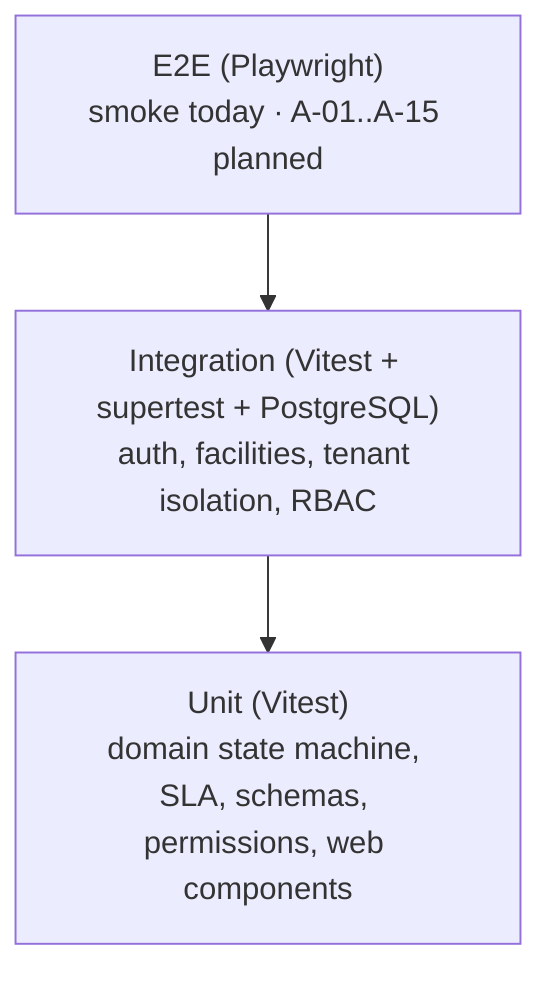

# Test strategy

## Principles

- **Test first.** New behaviour starts with a failing test (red → green → refactor).
- **Pure domain logic is exhaustively unit-tested.** Lifecycle, SLA, recurrence, ledger and cost
  rules live in side-effect-free modules so every branch can be exercised without a database.
- **Integration tests use real PostgreSQL**, never mocks of SQL, because tenant isolation,
  constraints and transactions are what we need to prove.
- **E2E tests drive the real app** (Vite + API + local database) through Playwright.

## Pyramid

| Layer                           | Tooling                        | Location                     | Current count |
| ------------------------------- | ------------------------------ | ---------------------------- | ------------: |
| Unit: shared domain and schemas | Vitest                         | `packages/shared/test/**`    |           125 |
| Unit + HTTP: API (no DB)        | Vitest, supertest              | `apps/api/test/*.test.ts`    |            61 |
| Integration: API + PostgreSQL   | Vitest, supertest, `pg`        | `apps/api/test/*.db.test.ts` |            16 |
| Unit: web                       | Vitest, Testing Library, jsdom | `apps/web/test/**`           |            15 |
| E2E                             | Playwright (Chromium)          | `e2e/tests/**`               |             4 |

## Coverage gates

- Global target **≥ 80 %** lines, branches, functions and statements (enforced by thresholds in
  `packages/shared/vitest.config.ts`; API and web thresholds are added with AO-060).
- `packages/shared/src/domain/**` is held to **100 %** in all four metrics. Current result: 100 %.
- CI runs `npm run test:coverage` on every push and pull request.

## Test data

- Integration suites reset the schema of a disposable database (`<db>_test`), run all migrations
  and the development seed, then create anything else they need through the API.
- Suites run with `fileParallelism: false` because they share that database.
- E2E uses the development database seeded by `./run.sh`; `./run.sh reset --yes` restores a known
  state. The full PRD §8 dataset arrives with AO-009.
- Demo credentials are development-only and documented in the README.

## What is covered today

| Area                     | Spec                                                                                         | Highlights                                                                                                                |
| ------------------------ | -------------------------------------------------------------------------------------------- | ------------------------------------------------------------------------------------------------------------------------- |
| Work-order state machine | `packages/shared/test/domain/work-order-state-machine.test.ts`, `work-order-closure.test.ts` | Graph, per-role guards, assignee rules, checklist gate (A-05), approval gate (A-08), self-approval, locking, immutability |
| SLA calculator           | `packages/shared/test/domain/sla.test.ts`                                                    | Policy resolution, due dates, at-risk at 80 %, breach boundary, response vs resolution stop points, dedupe (A-10)         |
| Permissions and roles    | `packages/shared/test/permissions.test.ts`                                                   | PRD §3 matrix                                                                                                             |
| Facility schemas         | `packages/shared/test/facility-schemas.test.ts`                                              | Code normalisation, time zone validation                                                                                  |
| Facilities slice         | `apps/api/test/facilities.db.test.ts`                                                        | Pagination, search, create + audit, 409 duplicate, 422 validation, 403 role, **404 cross-tenant**, users.role CHECK       |
| Pending API surface      | `apps/api/test/pending-routes.test.ts`                                                       | 25 routes return 501 + ticket; permission guards return 403 first                                                         |
| Auth                     | `apps/api/test/integration.db.test.ts`, `auth.service.test.ts`                               | Login, CSRF, logout, generic errors                                                                                       |
| Web                      | `apps/web/test/FacilitiesPage.test.tsx`, `navigation.test.ts`                                | List, create, validation, role-based form and navigation                                                                  |
| Smoke                    | `e2e/tests/smoke.spec.ts`                                                                    | Login, facilities list, role navigation, pending screen ticket                                                            |

## PRD §9 acceptance tests

| Test                             | Planned spec                                                           | Layer                           | Ticket | Status                    |
| -------------------------------- | ---------------------------------------------------------------------- | ------------------------------- | ------ | ------------------------- |
| A-01 Sign in as all four roles   | `e2e/tests/roles.spec.ts`                                              | E2E                             | AO-056 | ⏳ (smoke covers 2 roles) |
| A-02 Cross-organization access   | `e2e/tests/tenant-isolation.spec.ts` + one `*.db.test.ts` per entity   | E2E + integration               | AO-056 | 🟡 facilities done        |
| A-03 Requester files broken AC   | `e2e/tests/work-order-request.spec.ts`                                 | E2E                             | AO-057 | ⏳                        |
| A-04 Manager assigns technician  | `e2e/tests/work-order-assign.spec.ts`                                  | E2E                             | AO-057 | ⏳                        |
| A-05 Close without checklist     | `e2e/tests/work-order-checklist.spec.ts`                               | E2E (domain unit ✅)            | AO-057 | 🟡                        |
| A-06 Issue two of three          | `apps/api/test/stock-ledger.db.test.ts`, `e2e/tests/inventory.spec.ts` | Integration + E2E               | AO-058 | ⏳                        |
| A-07 Concurrent over-issue       | `apps/api/test/stock-ledger.db.test.ts`                                | Integration (parallel requests) | AO-058 | ⏳                        |
| A-08 Approval required           | `e2e/tests/approvals.spec.ts`                                          | E2E (domain unit ✅)            | AO-058 | 🟡                        |
| A-09 Idempotent PM generation    | `apps/api/test/run-due.db.test.ts`                                     | Integration                     | AO-058 | ⏳                        |
| A-10 SLA breach badge and alert  | `e2e/tests/sla.spec.ts`                                                | E2E (domain unit ✅)            | AO-058 | 🟡                        |
| A-11 Complete and close          | `e2e/tests/work-order-close.spec.ts`                                   | E2E                             | AO-057 | ⏳                        |
| A-12 CSV import errors           | `e2e/tests/asset-import.spec.ts`                                       | E2E                             | AO-059 | ⏳                        |
| A-13 Persistence across restarts | `e2e/tests/persistence.spec.ts`                                        | E2E                             | AO-056 | ⏳                        |
| A-14 Rejected uploads            | `e2e/tests/uploads.spec.ts`                                            | E2E                             | AO-059 | ⏳                        |
| A-15 Filtered CSV export         | `e2e/tests/reports-export.spec.ts`                                     | E2E                             | AO-059 | ⏳                        |

Unit tests still to come (PRD §9 last paragraph): recurrence dates (AO-038), inventory movement
(AO-042), approval policy (AO-045) and cost computation (AO-048).

## Running each layer

| Goal                                                             | Command                                                              |
| ---------------------------------------------------------------- | -------------------------------------------------------------------- |
| Everything CI runs (lint, format, typecheck, unit + integration) | `./run.sh check`                                                     |
| Unit + integration only (creates `<db>_test`)                    | `./run.sh test`                                                      |
| One workspace                                                    | `npm test -w @assetops/shared` (or `@assetops/api`, `@assetops/web`) |
| Coverage                                                         | `npm run test:coverage`                                              |
| Playwright smoke (starts or reuses the app)                      | `./run.sh e2e` or `npm run test:e2e`                                 |

Integration suites are skipped automatically when `TEST_DATABASE_URL` is not set; `./run.sh test`
always sets it.
